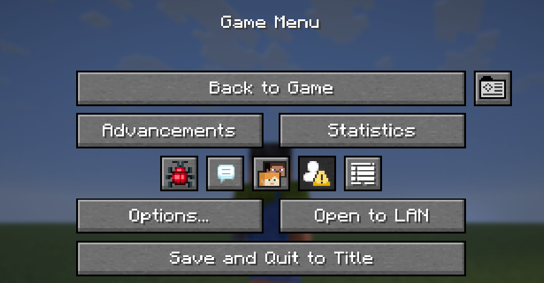
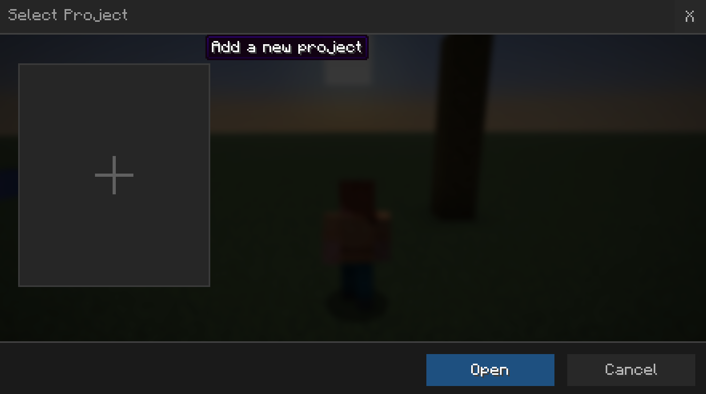
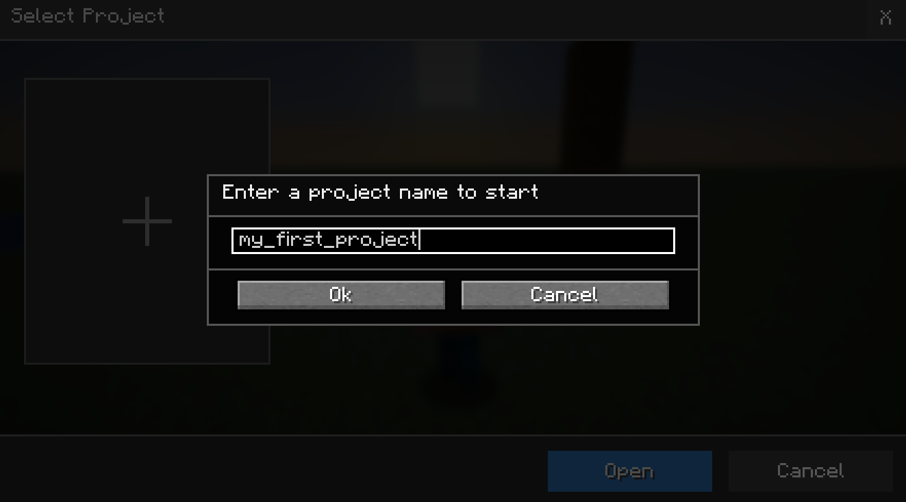
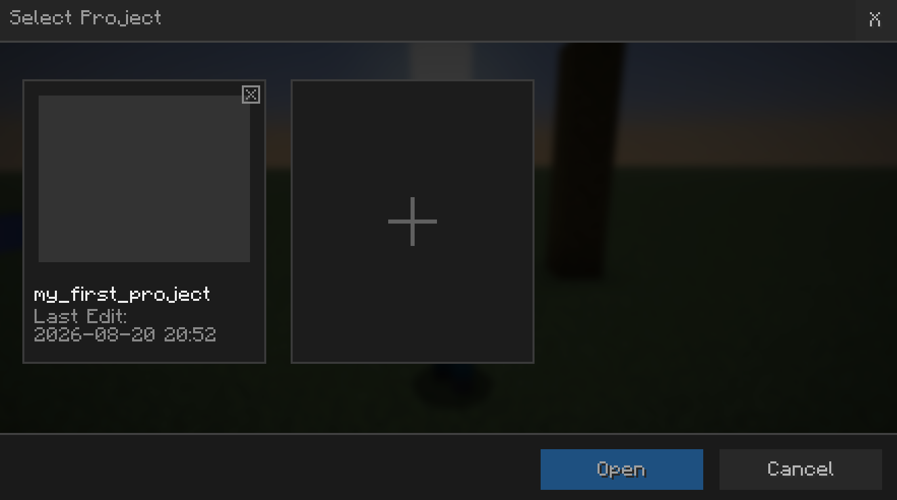
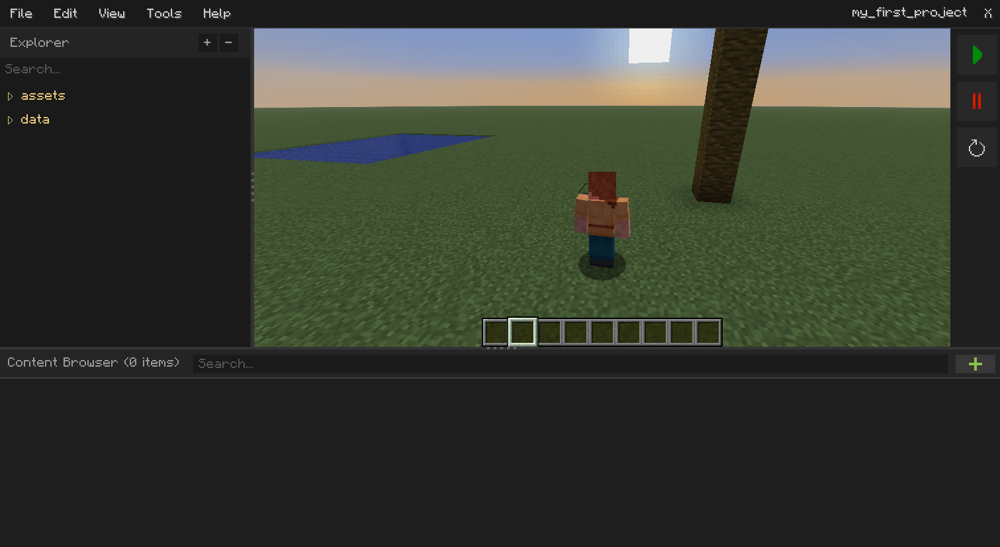
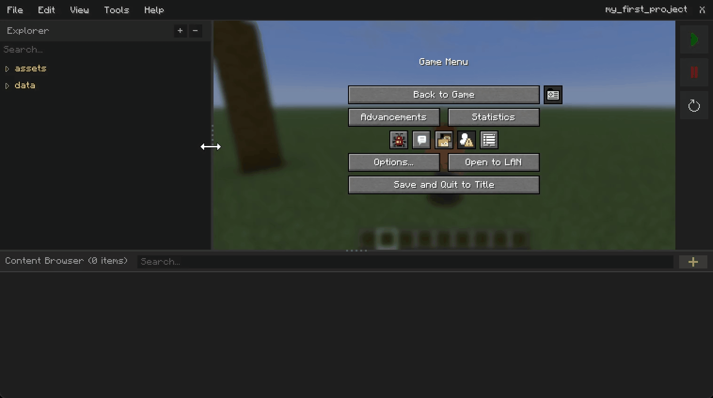
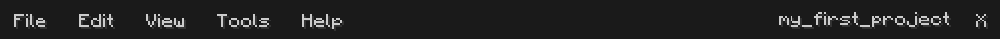
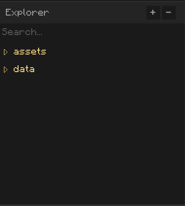
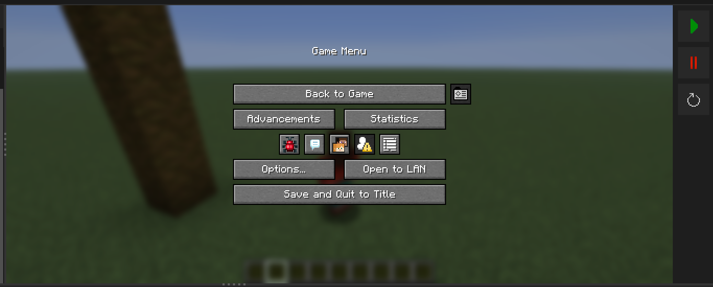
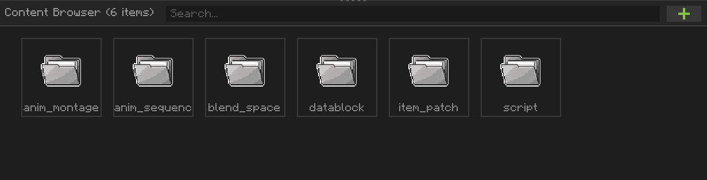

# Getting Started with Akythera & AkytheraLabs

Welcome to Akythera! Akythera is heavily inspired by Unreal Engine 5, a commercial engine used for
developing AA+ games, so if you have experience with that tool, you'll be able to pick up the
terminology and the principles behind how Akythera works very quickly.

In this section, you'll learn how to set up an Akythera project.

## Generate your first project

---

On the Game Menu screen, you'll see a project button next to the "Back to Game" button. You can
only open Akythera projects in a singleplayer world, and the world must not be opened to LAN.

When you first open the project selection screen, you'll see an empty project list with an add
button. Press it to create a new project.

Enter your project name, then press OK.

Now you'll see that the project has been generated. Open the project by double-clicking the project
widget, or press "Open" at the bottom right.

## Main Layout

---

You've successfully generated and opened your first Akythera project! You can see the editor's
main layout with the game viewport embedded in it. You can drag the panel separators to resize the
space each panel occupies.

Here's what each panel does:

### Top Menu Bar

Provides multiple options to manage the project or configure preferences. The name of the project
appears on the right side, along with a project close button that lets you quit the project editor
layout and get back to the Minecraft-only viewport.

### Explorer Panel

A place where you can browse the Akythera project's directories, which are pre-categorized for each
dataset. You may create subdirectories for better organization wherever they're allowed.

The directories with *yellow* text are concrete directories that will be exported exactly the same
way into resource and data packs, so you can't remove or rename them. Some directories won't even
allow creating new folders under them, because the data file path itself is an identifier for the
engine.

### World Viewport

You can play the game as usual while the Akythera Labs editor is open. You can test scripts and data
objects right after you finish working in the editor. You can release the mouse pointer with
`Shift + F1`. The buttons on the right side of the panel, from the topmost down, resume, pause, and
reload resource & data packs.

### Content Browser

When you select any directory in the **Explorer Panel**, its subdirectories and files appear in the
content browser panel. Just like OS file explorers, you can open an editor by double-clicking an
icon, or right-click to bring up the actions you can perform on that file.

You can press the green "+" button to add a new entry. It may ask you to select a pre-existing
object, such as an Item, an Entity, or a Block whose behavior you want to change, or to open a file
explorer to import an asset. You can also drag and drop files from your desktop to import assets.
