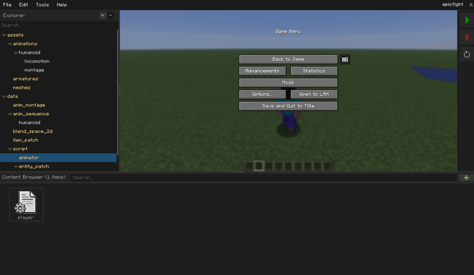
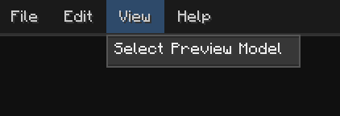
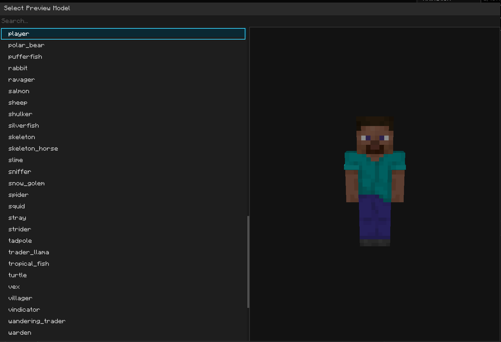
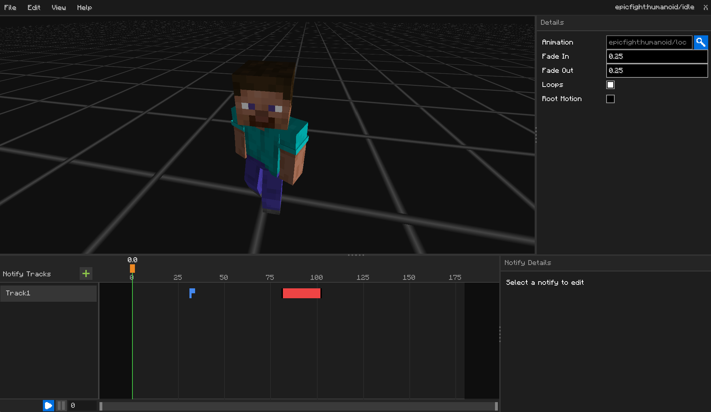

# Akythera Labs Editors

Akythera Labs is a visual toolset for building animated entities and gameplay
behaviour without writing code. You author your content in a set of dedicated
editors, one for each kind of asset, and the editor turns your work into
something the game can play at runtime. (Either resource & data packs or source code)

This guide walks through each editor: what the asset is for, what every panel
does, and what each property means.

## The asset editors

| Editor | Use it to build… | In short |
|--------|------------------|----------|
| [Project Editor](ProjectEditor.md) | Your whole project | The home base: browse, import, and open your assets, and export the finished project. |
| [Animation Sequence Editor](AnimationSequenceEditor.md) | A single animation | Wrap one animation clip with fade, looping, root motion, and event markers. |
| [Animation Montage Editor](AnimationMontageEditor.md) | A stitched-together animation | Chain several clips into sections you can jump between — attacks, combos, reload sequences. |
| [Blend Space 2D Editor](BlendSpace2DEditor.md) | A blended animation | Smoothly blend between animations based on two inputs, like speed and direction. |
| [Animator Blueprint Editor](AnimatorBlueprintEditor.md) | Animation logic | A node graph that decides which animation plays and when — state machines, transitions, variables. |
| [Entity Blueprint Editor](EntityBlueprintEditor.md) | Custom entity behaviour | Attach components and script the events (`On Construct`, `On Join World`, `Update`) that drive an entity. |

## Shared, common features in every editor

Once you know these, every editor feels familiar.

### The Preview viewport

Most editors show a live 3D preview of your work on a real model. You can orbit
the camera around it, and it plays your animation as you edit so you see changes
immediately.

- **View > Select Preview Model** lets you choose which model to preview on.

The choice is saved with the asset, so it re-opens on the same model next time.

### The Details panel

Properties — number edit boxes, checkboxes, combo boxes with selectable items,
and so on — live in a **Details** panel. Type a number and press Enter to commit
it; click a checkbox to toggle it.

### Saving and unsaved changes

- Press **Ctrl+S** or choose **File ▸ Save** to save.
- While you have unsaved changes, the asset's name in the title bar shows a
  **`*`**. Saving clears it.
- If you try to close an editor with unsaved changes, you'll be asked whether to
  **Save & Close** or **Close Without Saving**. Closing without saving throws away
  your edits since the last save.

### Undo and redo

**Ctrl+Z** undoes and **Ctrl+Y** redoes. Nearly every change — dragging a node,
editing a number, adding a marker — can be undone.

### Rearranging the layout

The panels are separated by draggable dividers. Drag a divider to resize the
panels; each editor remembers its layout the next time you open it.

### Renaming an existing file will automatically redirect references

Akythera internally manages holders which have actual objects and its path. When
you change the name of those asset files the holder is automatically redirected
to a newer path so you don't need to manually remap the call sites one by one.