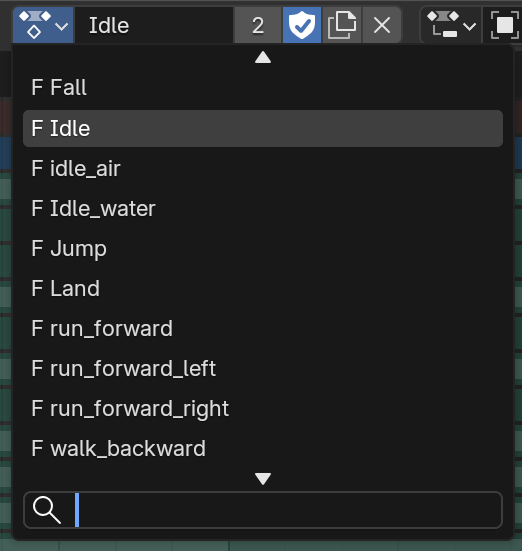
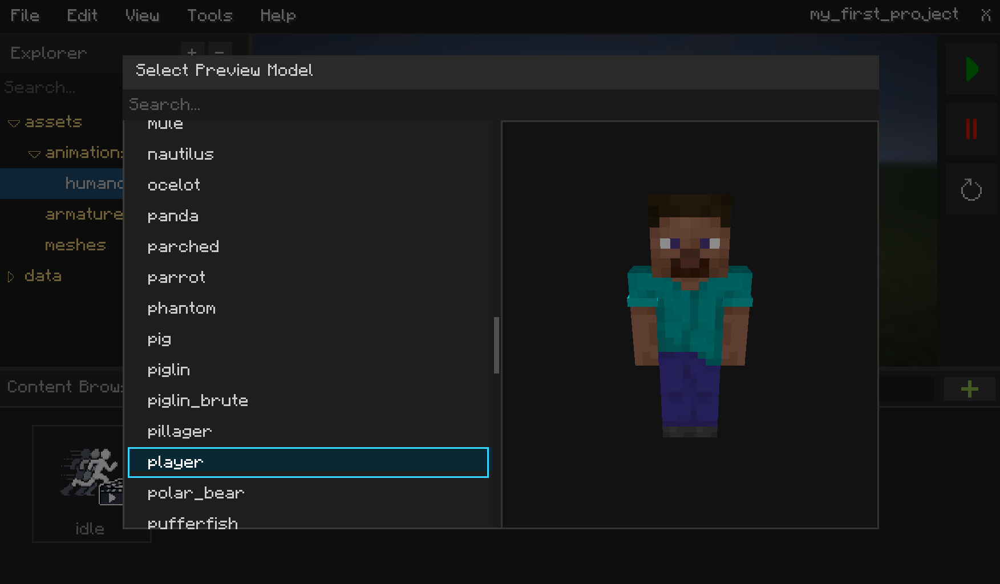
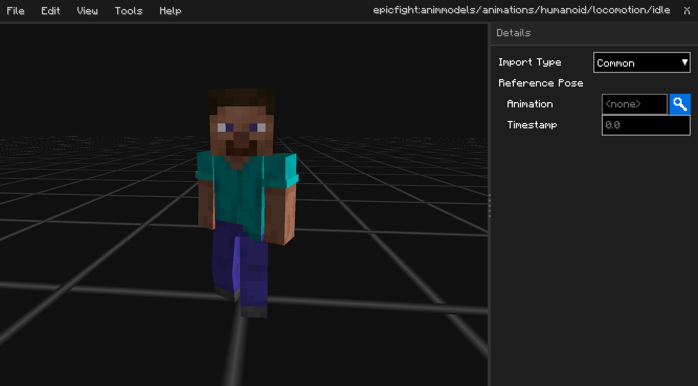

# What an animation is

An animation is an asset that records the movement of the bones in an [Armature](Armature.md). Akythera supports
playing animations on both the client and the server side, since a few features require bone movements to be
synchronized. (e.g. a weapon collider that follows a hand bone, so collisions can be detected on the server side.)

Inside Blender, animations exist as "Actions", sets of keyframes that describe the bones' transforms at a specific
time.

## Importing animations

When you [drag & drop assets to import](../GettingStarted.md) animations, you'll see a popup screen that lets you
select a model, which is then saved to disk. This applies to every animation asset if you drag & drop multiple files
at once. The model must have a compatible armature hierarchy to play the animations.

> Note: To play the animations properly, you must [map entity types by armatures]() in the project settings.

Once you select the model, you can see the animation playing.

## Animation Metadata

The animation asset editor screen shows two properties: Import Type and Reference Pose. They're saved into a `.akmeta`
file that has the same name as the `.akasset` file.

### Import Type

| Import Type | Meaning                                                          |
|-------------|------------------------------------------------------------------|
| Common      | Reads animation transform data as-is                             |
| Additive    | Reads animation transform data by subtracting the **reference pose** |

[Additive Animations]() are useful for implementing jumping and hit animations. Refer to that document for more
information.

### Reference Pose

This is only valid when **Import Type** is set to **Additive**. It takes the pose to subtract from another animation
(or from this animation itself, if **Animation** is empty) and a timestamp, then subtracts that pose from all transform
data while importing.
