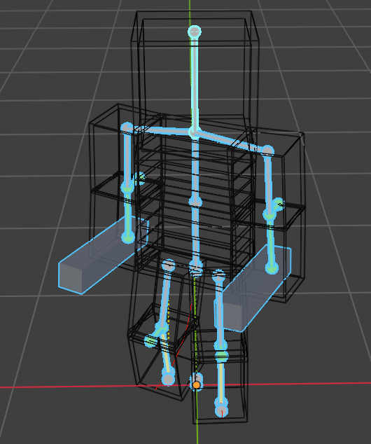
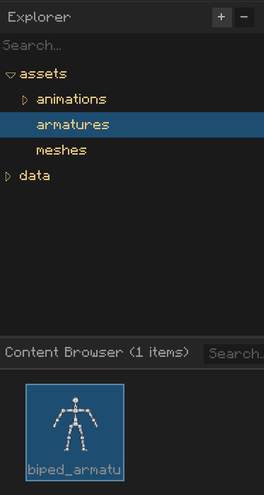
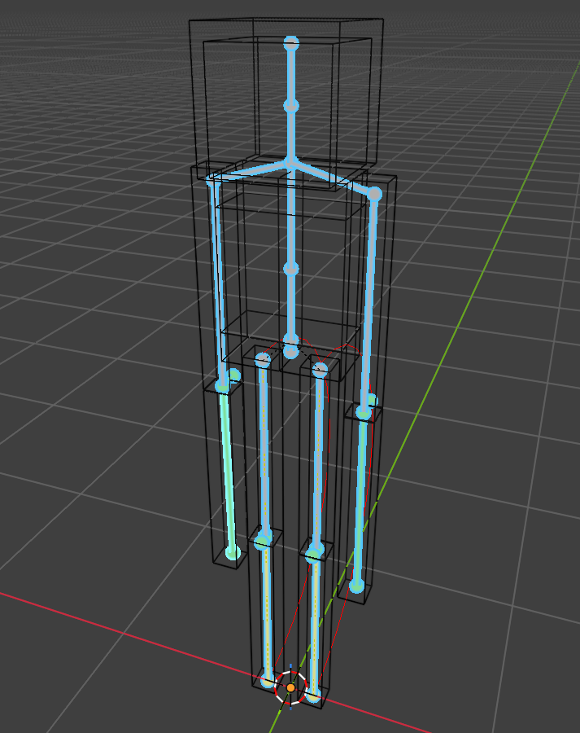
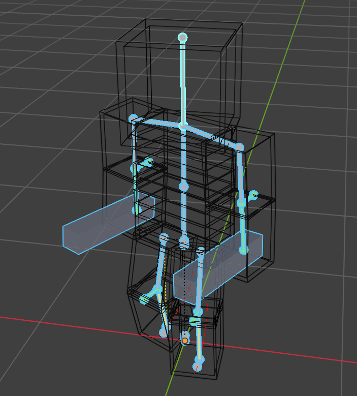
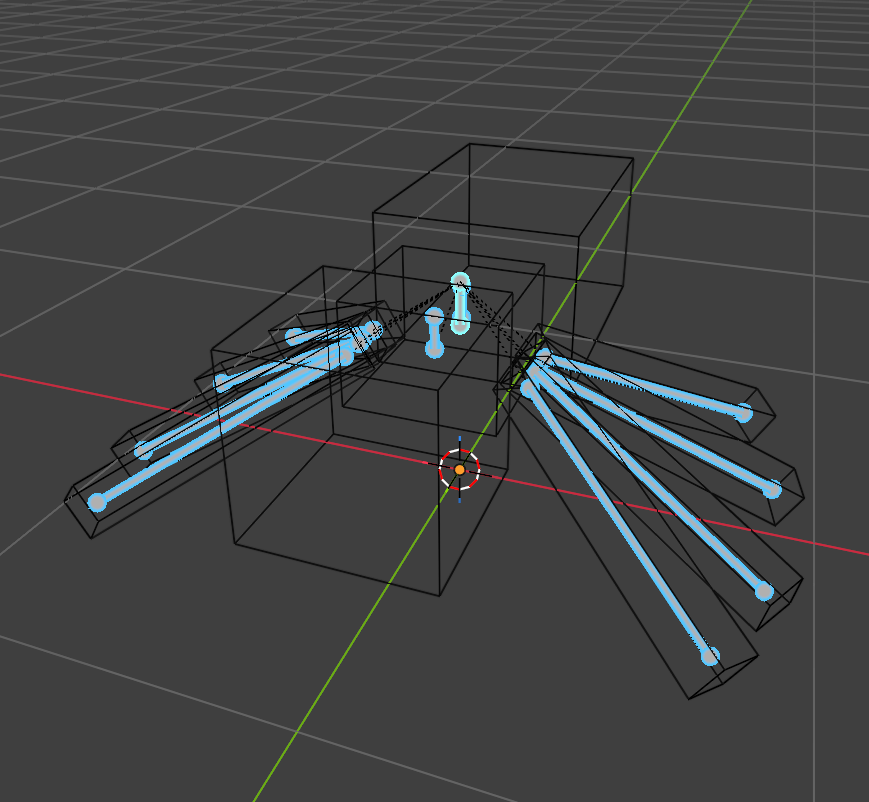
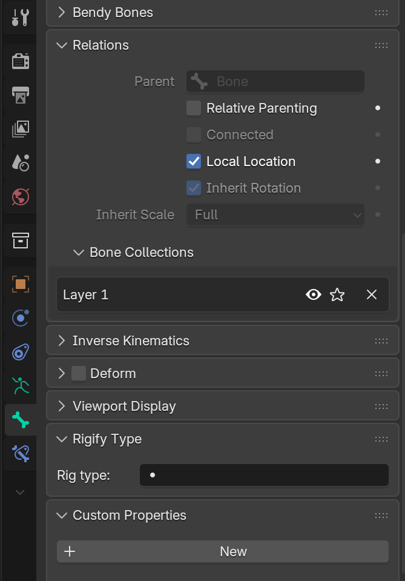

# What an armature is

An armature is a component that plays animations and syncs the animated pose to a [Mesh]() or any other in-game object
attached to it. It consists of a set of **Bones** in a tree hierarchy, where a parent bone's transform propagates to
all of its child bones.

*An armature in Blender, highlighted in cyan.*

In AkytheraLabs, you put armature assets in the "armatures" directory in the editor.

*The imported armature is shown in the content browser panel.*

## Armature compatibility

Some armatures can share [Animations](Animation.md) if they have the same bone names and the same parent-child
hierarchy. Akythera checks animation compatibility leniently instead of crashing the game, so deciding which animations
to share between which armatures is entirely up to you.

*These example player and enderman armatures have a very similar structure, so if you name the bones to match, they can
share animations.*

*The spider, however, has a bone hierarchy very different from a human-like one, so sharing animations with it is
almost impossible.*

## Bones for special purposes

### Root bone

The Akythera modeling convention strongly recommends adding a bone named "root" with no transform applied. This is for
the [Root Motion]() system, where you can sync an entity's in-game location to the root bone's movement in an
animation.

### IK (Inverse Kinematics) bones

IK bones are bones that only exist in Blender, for animation convenience. They remove the need to assign transforms one
by one, which shortens the time it takes to create a new animation and makes the movement look more natural.

*The bones at each leg's foot are the IK bones, which determine each leg's pose in reverse.*

> NOTE: You must uncheck the "Deform" option on these bones to exclude them from being exported.
> 

### Bendy controller bones for angular deformation

This is a mesh deformation trick that makes bendy parts look *angular*. It is not an official Blender technique, but
rather how Akythera suggests expressing blocky bends to fit the Minecraft mood.

As you can see, the size and rotation of the bone inserted between the upper and lower arm expands and shrinks
according to the lower arm's rotation. This is a trick that uses Bone Constraints in Blender. It won't be covered in
this document. If you want to know more about it, check the reference `.blend` files [here]().

> Note: bones of this type should be included in the exporting stage.

### Bones suffixed with "_bend"

Akythera bones 
