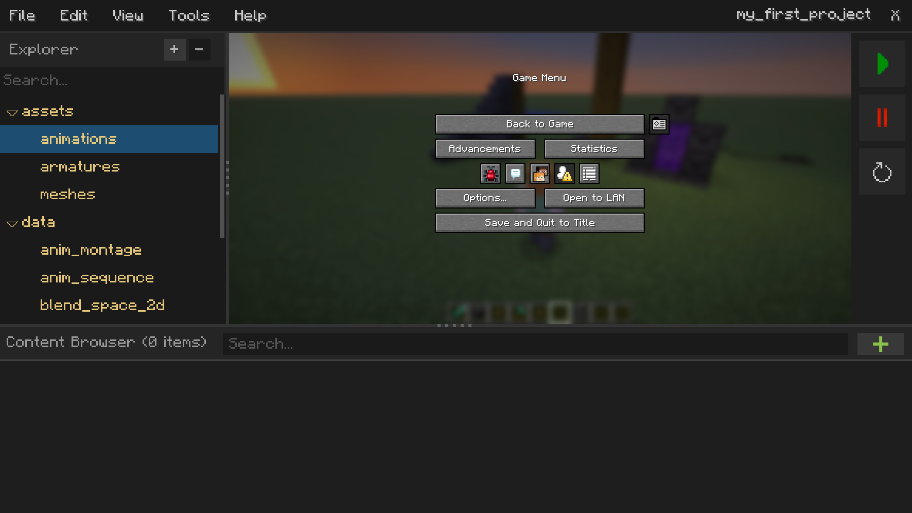
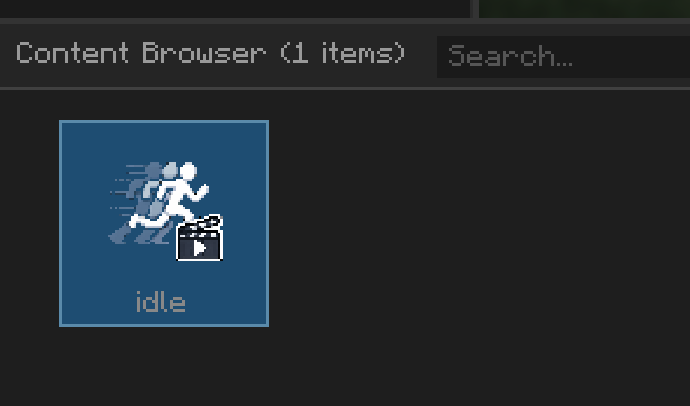
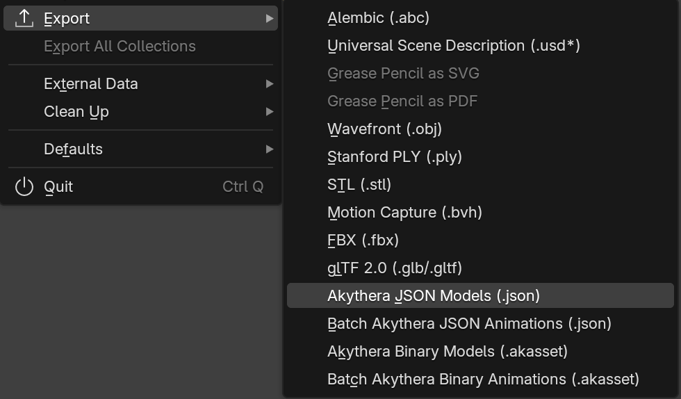

# Introduction

Akythera accepts three broad types of assets: Mesh, Armature, and Animation. All of them are managed by Minecraft's
resource system, which loads assets on demand.

All three Akythera asset types are stored in a binary format with the `.akasset` file extension, along with `.akmeta`
metadata in JSON format. If you want to know how to create assets, refer to
[How to use Blender with the Akythera exporter]().

`.akmeta` is an asset metadata file created by Akythera itself, not by the Blender export.

## Importing assets into an Akythera project

Drag & drop asset files, or press the green plus button next to the search box. You can only add assets that match the
directory currently selected in the [explorer panel]().

Only lowercase letters and "_" are allowed in file names, to comply with Minecraft's resource naming rules.

Once the assets are added, their file icons appear in the content browser panel.

## Generating your assets

Most Akythera assets are made in Blender. Once you have successfully installed the
[Akythera Blender importer/exporter](), you'll see import/export options named **Akythera**.

This document doesn't explain how to use Blender, since that's outside the scope of this topic.

> Note: the JSON export options exist only to support legacy versions. We strongly recommend the binary export
> options for better loading speed and smaller file size.

## Handling old JSON asset files

If you previously developed for **Epic Fight 1.21.1 or below**, all of your assets are probably in JSON format. If you
still have the original `.blend` files, the best practice is to export them all again as `.akasset` with the new
exporter. But if you have lost them and only have the JSON assets, you can use the [Animation Retargeter]() and the
[Mesh Transformer]().

# See also

- [Mesh](Mesh.md)
- [Armature](Armature.md)
- [Animation](Animation.md)
