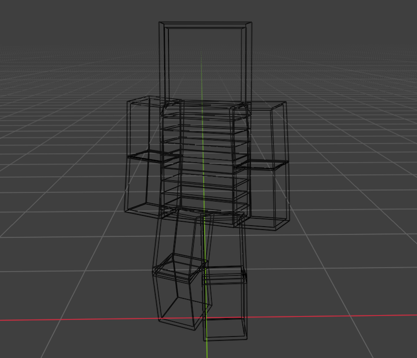
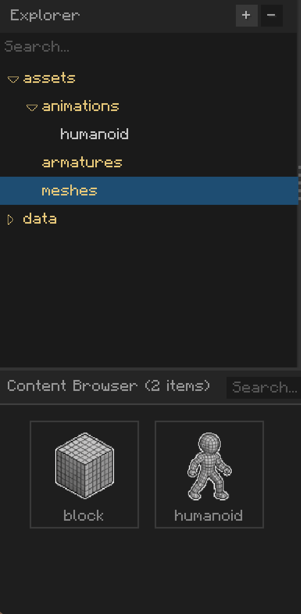
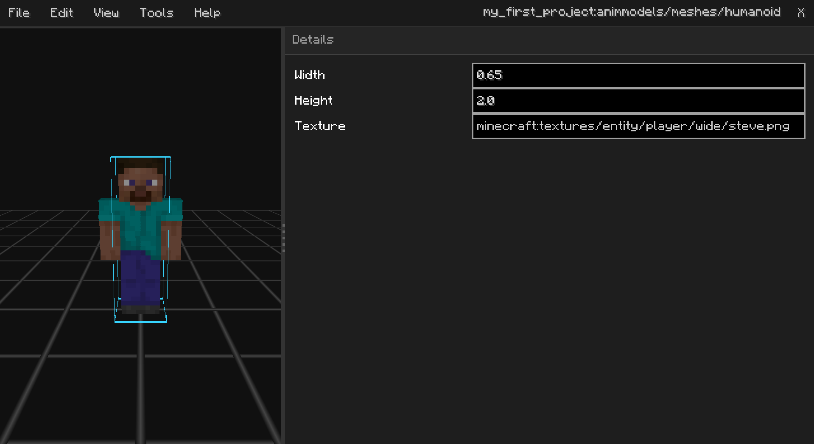

# What a mesh is

A mesh is the primary component that draws shapes on the screen. Akythera has two types of meshes, depending on their
purpose — *Static* and *Skeletal* meshes.

*A mesh in Blender. It consists of multiple faces and the vertices that make them up.*

In AkytheraLabs, you put mesh assets in the `meshes` directory in explorer panel. AkytheraLabs automatically detects
whether an imported mesh is Static or Skeletal.

*Imported meshes are shown in the content browser panel. The left one is Static, and the right one is Skeletal.*

---

# Static vs Skeletal meshes

Static meshes are meshes that never change at runtime. They are relatively faster than Skeletal meshes because they
need no runtime binding for mesh deformation. They are suitable for objects that have a fixed shape, such as particles,
blocks, and items.

Skeletal meshes, unlike Static meshes, are a special type of mesh whose shape can change at runtime. Technically, all
Skeletal meshes are a subset of Static meshes, but they require extra data for runtime deformation.

To draw Skeletal meshes, you need additional assets to deform the mesh at runtime—[Animations](Animation.md) and
[Armatures](Armature.md), which are the two other fundamental asset types in Akythera.

## Mesh Metadata

A mesh asset can have metadata properties as below:

| Name    | What it does                                                    |
|---------|-----------------------------------------------------------------|
| Width   | The width of the mesh's visual volume                           |
| Height  | The height of the mesh's visual volume                          |
| Texture | The texture location used when previewing the mesh **in the editor** |
